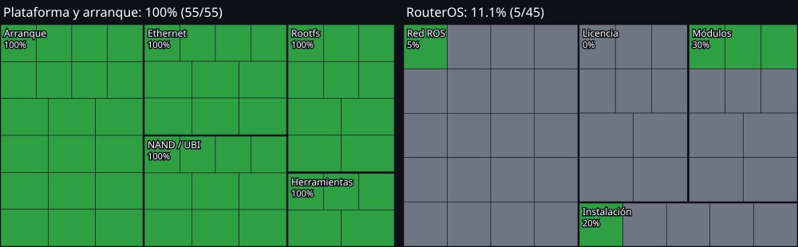

# Port status and progress



**60% complete (60/100 weighted points).** Last updated: **2026-11-19**.
The map is generated from [progress.json](routeros-port/progress.json) by
[tools/progress.py](routeros-port/tools/progress.py).

> The percentage tracks verified engineering milestones, not lines of code or
> overall RouterOS usability. RouterOS and its root filesystem are MikroTik
> software; this repository does not redistribute them or bypass licensing.

## Reading the map

The map has two panels:

- **Platform and boot:** 55 weighted points; verified in the current scope.
- **RouterOS:** 45 weighted points; 5 completed.

Each cell represents one weighted point. Green cells are complete and gray
cells are pending. Partial and blocked states are detailed below.

Regenerate the map from the `routeros-port/` directory:

```bash
python3 tools/progress.py
```

## Milestones

| # | Area | Weight | Complete | Status | Evidence |
|---:|---|---:|---:|---|---|
| 1 | Boot and platform | 20 | 20 | Verified | [BOOT-TFTP.md](routeros-port/docs/BOOT-TFTP.md), console |
| 2 | Ethernet/switch/PHY in Linux | 10 | 10 | Verified | GSWIP probe and 1 Gbps link |
| 3 | NAND/UBI/UBIFS read-only | 10 | 10 | Verified | [NAND-UBI.md](routeros-port/docs/NAND-UBI.md), BBT |
| 4 | RouterOS rootfs/overlay/shell | 10 | 10 | Verified | Historical hardware logs |
| 5 | RouterOS modules | 10 | 3 | Partial | `Unknown symbol` diagnostics |
| 6 | Networking in RouterOS | 20 | 1 | Blocked | `packet_hook`, `switch`, `bridge2` |
| 7 | RouterOS license | 10 | 0 | Blocked | `Demo license expired!` |
| 8 | Persistent installation/`.y3` | 5 | 1 | Partial | [FLASH-Y3.md](routeros-port/docs/FLASH-Y3.md) |
| 9 | Remote tools and documentation | 5 | 5 | Verified | `catch_final.py`, `uboot_cycle.py` |
| | **Total** | **100** | **60** | **60%** | |

### Verified on hardware

- Linux 5.6.3 for `mipsbe`, built for the GRX350 and booted over TFTP to RAM.
- Serial console on `ttyLTQ0` at 115200 8N1.
- 1 Gbps Linux Ethernet through DSA, GSWIP XRX500, and XWAY PHY.
- 128 MiB Macronix NAND with BCH-4 ECC and a bad-block table.
- Read-only UBI/UBIFS mounts for `rootfs_0` and `rootfs_1`.
- RouterOS SquashFS root filesystem, temporary overlay, and inspection shell.
- RouterOS `flash.ko` loaded.

### Current blockers

- **RouterOS networking:** RouterOS modules require proprietary fastpath
  symbols; no compatible GSWIP driver is available in the included sources.
- **RouterOS licensing:** `getHardwareID` reports that it cannot obtain the
  expected disk identity from `/dev/mtdblock0`; the ED500 NAND contains
  Genexis/Adamo firmware, and the check ends with `Demo license expired!`.
  The available documentation does not show a key-generator attempt or a
  failure to write NAND. The current workflow does not write NAND.
- **Persistence:** `.y3` research is incomplete. No persistent installation or
  NAND recovery has been tested.
- **Final artifact:** `out/uImage-563` compiled and was packaged, but the latest
  on-device tests used earlier builds (#29/#62). Retest the exact artifact
  before calling it verified.

## Area details

### 1. Boot and platform — 20/20

U-Boot receives `out/uImage-563` over TFTP and runs `bootm` at `0x80500000`.
The 5.6.3 kernel includes the GRX350 memory map, `ttyLTQ0` console, required
clocks, and reset support.

The final artifact compiled successfully (`vmlinux` 96,385,720 bytes;
`uImage` 19,672,756 bytes; MD5
`1a780fdd76b9da701974b17af1102be6`) but needs another hardware boot test.

**Next:** boot the exact image and record TFTP size, console output, and shell
status alongside its checksum.

### 2. Ethernet, switch, and PHY in Linux — 10/10

Linux detects the GSWIP XRX500 through DSA, initializes the XWAY PHYs, and
establishes a 1 Gbps link. This verifies Linux networking only; it does not
provide working RouterOS networking.

**Next:** no additional Linux driver work is planned for the current scope.

### 3. NAND and UBI read-only — 10/10

The NAND is detected with BCH-4 ECC and `nand-on-flash-bbt`. UBI attaches, and
the stock rootfs volumes mount read-only. No NAND write or recovery test has
been performed.

**Next:** do not attempt persistence without a verified backup and tested
recovery plan. The project workflow remains TFTP to RAM.

### 4. RouterOS rootfs, overlay, and shell — 10/10

The initramfs can mount the separately obtained RouterOS 7.17 `mipsbe` SquashFS
root filesystem with a temporary overlay and open an inspection shell. Earlier
hardware logs (#29/#62) record this behavior; the final image needs retesting.

### 5. RouterOS modules — 3/10

`flash.ko` loads. `packet_hook.ko`, `switch.ko`, `bridge2.ko`, and
`phy_helper.ko` require symbols not found in the published GPL sources or
included modules, including `netif_receive_try_fp`, `fast_path_start_xmit`,
`register_fast_path`, and `phy_setup`. These diagnostics point to missing
platform components, not an additional `insmod` step.

### 6. Networking in RouterOS — 1/20

Linux Ethernet is verified, but RouterOS network modules do not link because
they require MikroTik fastpath components. The project does not redistribute
proprietary binaries or bypass those dependencies.

### 7. RouterOS license — 0/10

RouterOS reports `Demo license expired!`. The recorded diagnostic says
`getHardwareID` cannot obtain the expected disk identity from
`/dev/mtdblock0`; this ED500 has Genexis/Adamo firmware in NAND. This repository
does not provide license patches, key generators, software-ID modifications,
or instructions to evade the check. Use RouterOS only with a valid license for
the hardware.

### 8. Persistent installation/`.y3` — 1/5

The `.y3` format has been investigated, but a persistent installation has not
been tested. The project does not provide a NAND-writing procedure. See
[FLASH-Y3.md](routeros-port/docs/FLASH-Y3.md) for a non-operational summary.

### 9. Remote tools and documentation — 5/5

`catch_final.py` combines the U-Boot catcher and TFTP server;
`uboot_cycle.py` supports serial reset and boot cycles; `build-563.sh` builds
the image. The progress map is generated from versioned data.

## Other blockers

### RouterOS fastpath and switch

RouterOS networking depends on MikroTik components that are absent from the
published sources available to this project. The GSWIP in the GRX350 is not
supported by the included RouterOS switch driver. Linux Ethernet support does
not resolve this separate dependency.

### License and software ID

The documented `getHardwareID` error and expired demo license are licensing
status, not a NAND ECC or UBI issue. There is no evidence in these documents
that a key generator failed to write NAND; the current project workflow is
read-only and does not attempt such a write.

### NAND persistence

TFTP boot is temporary. No `.y3` write, NAND update, or recovery has been
verified. Do not treat the historical format research as an installation
procedure.

## Next milestones

| Milestone | Current | Target | Requirement |
|---|---:|---:|---|
| RouterOS networking | 5% | 100% | A lawful, compatible implementation of the required components |
| RouterOS licensing | 0% | — | A valid license for the hardware; license bypass is out of scope |
| Persistent installation | 20% | 100% | Backup, geometry, recovery plan, and controlled validation |
| Final artifact tested | Pending | Verified | Boot `out/uImage-563` and record results |

Do not increase a milestone without reproducible evidence.

## Current artifact

| Field | Value |
|---|---|
| File | `out/uImage-563` |
| Size | 19,672,756 bytes |
| MD5 | `1a780fdd76b9da701974b17af1102be6` |
| `vmlinux` | 96,385,720 bytes |
| Load/entry | `0x80500000` |
| Kernel | Linux 5.6.3 |
| Latest hardware test | Earlier builds #29/#62 |
| Status | Built and packaged; final artifact not retested |

A checksum identifies the documented artifact but does not prove that it has
booted. Retest TFTP, `bootm`, console, UBI mount, `flash.ko`, and the inspection
shell with the exact image.

## Port history

- **Research:** identified the GRX350, RouterOS 7.17 `mipsbe`/Linux 5.6.3,
  GPL sources, memory map, NAND layout, and UBI geometry.
- **Kernel:** built the 5.6.3 kernel, added console/clocks and GSWIP3/DSA
  support, and packaged a `uImage` for `0x80500000`.
- **Initramfs:** added the inspection environment, overlay, and optional
  RouterOS root filesystem.
- **Boot tooling:** added TFTP catcher, transfer-size verification, and remote
  reset/boot helpers.
- **Hardware tests:** verified kernel boot, console, Linux Ethernet, NAND/UBI
  read-only access, and the RouterOS inspection shell on earlier builds.
- **Current limits:** RouterOS network modules remain blocked; licensing is
  not resolved; persistent installation is untested; final artifact needs
  retesting.

## Progress calculation

- Each area has a weight; completion is based on verifiable milestones, not
  source lines.
- Points earned are `weight × percentage / 100`; weights total 100.
- `verified` means reproduced with evidence; `partial` means some work is
  functional; `blocked` means a dependency is outside the current project
  scope.
- A 100% area does not mean RouterOS is fully usable.

To update the map:

1. Update `routeros-port/progress.json` (`percent`, `state`, and `evidence`).
2. Run `cd routeros-port && python3 tools/progress.py`.
3. Review the SVG and rendered README.
4. Commit `progress.json` and `progress.svg` together.

Do not edit the generated SVG by hand.

## Reproduce the current state

Build:

```bash
cd routeros-port
sudo bash build-563.sh
md5sum out/uImage-563
```

Boot to RAM:

```bash
cd routeros-port
python catch_final.py --horas 6
```

Remote reset:

```bash
cd routeros-port
python uboot_cycle.py status
python uboot_cycle.py cycle
```

See [NAND-UBI.md](routeros-port/docs/NAND-UBI.md) for read-only checks. Do not
write NAND.

## Not tested

- The final `out/uImage-563` has not been booted on hardware.
- NAND writes, `.y3` installation, and recovery have not been tested.
- A valid RouterOS license has not been verified on this device.
- RouterOS networking has not been tested because required components are
  unavailable.
- Logs containing IP addresses or MAC addresses are not included.

## Related documentation

- [Repository README](README.md)
- [Build](routeros-port/docs/BUILD.md)
- [TFTP boot](routeros-port/docs/BOOT-TFTP.md)
- [NAND and UBI](routeros-port/docs/NAND-UBI.md)
- [Troubleshooting](routeros-port/docs/TROUBLESHOOTING.md)
- [`.y3` research status](routeros-port/docs/FLASH-Y3.md)
- [Contributing](routeros-port/CONTRIBUTING.md)
- [Legal notice](routeros-port/NOTICE.md)
