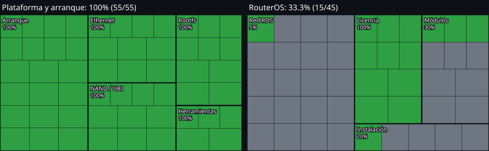

# Genexis Pure ED500 · port de RouterOS 7.17 (mipsbe)

Port de investigación de **RouterOS 7.17 mipsbe** al router **Genexis Pure ED500**
(Intel/Lantiq **GRX350**, MIPS BE interAptiv de dos núcleos), con arranque
**TFTP a RAM** para pruebas y un **`.y3` instalable en NAND** para que kernel,
config y logs persistan.

[Estado y progreso](docs/PROGRESS.md) ·
[Mapa visual](progress.svg) ·
[Documentación](docs/README.md) ·
[Cómo contribuir](CONTRIBUTING.md) ·
[Aviso legal](NOTICE.md)

> **Proyecto independiente.** No está afiliado a MikroTik, Genexis ni Intel/Lantiq.
> Este repositorio **no contiene ni redistribuye software de MikroTik**. El `.npk`
> de RouterOS y su rootfs se obtienen de MikroTik bajo sus propias condiciones.
> No hay ningún método para saltarse la licencia: si quieres usar RouterOS,
> necesitas una licencia válida.

---

## Qué es esto

El ED500 lleva un SoC GRX350 con dos núcleos MIPS interAptiv, NAND SLC de
128 MiB, switch GSWIP y PHYs XWAY. RouterOS 7.17 para `mipsbe` corre sobre Linux
**5.6.3**, el mismo kernel que MikroTik publica en sus fuentes GPL. La idea del
port es reutilizar ese kernel, parchear lo que falta del SoC y arrancar el
rootfs oficial de RouterOS **en RAM para probar** y, con el `.y3`, **en NAND**
para que la configuración persista.

El repo contiene las herramientas, parches y documentación del proceso. **No es
un firmware alternativo completo**: es un entorno de investigación reproducible.

## Estado, en corto



**71% del port completado (71/100 puntos de peso).** El treemap muestra en verde
lo verificado y en gris lo pendiente; el detalle y la evidencia están en
**[docs/PROGRESS.md](docs/PROGRESS.md)**.

- **Funciona en hardware:** kernel 5.6.3, consola `ttyLTQ0`, Ethernet DSA/GSWIP
  a 1 Gbps, NAND con BCH-4/BBT, UBI/UBIFS en lectura, rootfs de RouterOS con
  overlay y shell `~ #`, `flash.ko` con `/dev/flash`, `/dev/log` (`devlog`),
  **licencia aceptada** (`RouterOS is now licensed`), `sysinit` con 30
  servicios, **web/API arriba** (`http://192.168.1.2/` responde 200) y loader
  funcionando. El login queda pendiente de probar con la contraseña inicial.
- **Añadido en el build #97, pendiente de probar en placa:** botón de reset
  físico (GPIO0 pin 0, 5 s), LEDs Ethernet por SSO/PHY, LEDs del panel frontal
  (`led5`–`led7`, `led13`, `led14`) y RGB SK9822 en
  `/sys/devices/platform/canyon_led/sk9822/led_color`. El reset reinicia, pero
  con TFTP el U-Boot vuelve a la NAND stock si no hay cazador armado; el
  detalle y la lista de comprobación están en
  **[docs/HARDWARE.md](docs/HARDWARE.md)**.
- **Añadido en el build #98, pendiente de probar en placa:** instalación
  persistente en NAND. `out/ED500-routeros-7.17-nand.y3` lleva el kernel y el
  DTB para `rootfs_0`; U-Boot `iboot` arranca desde `/boot/uImage` +
  `/boot/norrland.dtb` sin TFTP; el init monta `/flash/rw` en NAND, borra el
  `pad` de 30 MB y resetea el flag `boot_cnt_primary` con `fw_setenv`.
  Instalación de **un solo banco** por `run update_image`; `rootfs_1` no se
  monta ni se arranca (solo copia stock para recuperación manual). Detalle:
  **[docs/FLASH-Y3.md](docs/FLASH-Y3.md)**.
- **No funciona todavía:** la red dentro de RouterOS (falta probar que
  `packet_hook` registre los puertos y que `switch.ko` enganche el GSWIP)
  y el primer login/Winbox con contraseña (el autorun de primer arranque fija
  `admin`/`ed500`; falta probarlo en placa). **La WAN es xDSL, no GPON:** el
  firmware stock `GNX-4.3.6.170-R` trae `vrx518.ko`, `drv_dsl_cpe_api.ko` y
  `/etc/init.d/dsl`, y ningún módulo PON/OMCI. RouterOS no tiene driver VRX518
  y el de Genexis es binario para 4.9.109. **Netinstall oficial no es
  posible** con el U-Boot de Genexis (MikroTik exige RouterBOOT/Etherboot); ver
  **[docs/HARDWARE.md](docs/HARDWARE.md#netinstall-y-actualización-web)**.
- **Artefacto actual:** `out/uImage-563` (build #102, 2026-11-22, 21.899.532 B,
  MD5 `e2e8698843a1278da58e5d9178c89f5a`) y
  `out/ED500-routeros-7.17-nand.y3` (53.613.270 B, MD5
  `3e9b37d712ad6610bbaa2dc7d7ae2ccb`, 422 LEBs). El #99 quita la restricción
  GPL-only; el #100 añade `ros-name = "ether1..4"` a los puertos DSA, que es
  lo que `net` lee en `/sys/class/net/<if>/of_node/ros-name`; el #101 hace
  que el autorun y `netup` prueben `ether1..4` y `lan1..4`; el #102 corrige
  el ABI de `struct net_device` (`NET_CLS_ACT=n`, `pcpu_refcnt` en 672),
  reduce `br_init` a stub y retira 18 exportaciones duplicadas para que
  `bridge2.ko` cargue. En QEMU malta 5.6.3 los cuatro módulos
  (`packet_hook`, `phy_helper`, `switch`, `bridge2`) cargan; falta la placa.
  reset/LEDs, `/flash/rw` persistente, un solo banco y el flujo `.y3`, pero
  **aún no se han probado en placa**. La última prueba real en placa es el
  build #93 (2026-11-20):
  `/flash` tmpfs, `flash.ko`, `/dev/flash`, `/dev/log` con `devlog`, licencia
  aceptada y `sysinit` hasta el `loader`; la NAND solo se lee.

El **mapa visual** está en `progress.svg`; el detalle completo, con la tabla de
hitos, evidencia, bloqueos y siguientes pasos, está en
**[docs/PROGRESS.md](docs/PROGRESS.md)**. El mapa es un treemap de dos paneles
(plataforma y RouterOS), con una celda por punto de peso.

### Los muros que quedan

1. **Red de RouterOS.** El build #96 exportó los símbolos del *fastpath* que
   faltaban (`netif_receive_try_fp`, etc.) y el #99 quitó la restricción
   GPL-only de las APIs que usan los módulos propietarios (`switchdev`,
   `workqueue`, GPIO, LED, hwmon...). La auditoría da cero pendientes en
   `packet_hook`, `phy_helper`, `switch`, `bridge2`, `flash`, `8021q` y
   `nf_nat`, así que `switch.ko` ya puede cargar. Queda probar en placa si su
   capa switchdev engancha los puertos DSA del GSWIP y si `bridge2` registra
   su tipo. El kernel ya llama a los hooks `rx_handler_hook`/`tx_handler_hook`
   del fastpath; falta probar que `packet_hook` registre los puertos y que el
   camino rápido no rompa el tráfico.
2. **Red, primer login y persistencia.** El loader ya no es el muro: con
   `/dev/jiffies` arranca los servicios y la web responde 200. Falta que el
   primer login con contraseña funcione en placa (el autorun fija
   `admin`/`ed500` en el primer arranque NAND), que `switch.ko` enganche el
   GSWIP por switchdev y que la instalación en NAND se confirme en hardware.
   La WAN xDSL (VRX518) sigue sin driver en RouterOS; el de Genexis es binario
   para 4.9.109. Lo que sí se puede dejar es RouterOS con la red Linux de
   gestión y una vuelta manual a Genexis por U-Boot; no es un MikroTik 100%.

---

## Quick start

### 1. Requisitos

- Linux o WSL2 con permisos para escribir en `/opt` (los scripts usan `/opt/ros-port`).
- Toolchain MIPS de Bootlin `mips32--glibc--stable-2024.05-1`.
- Fuentes Linux 5.6.3 + parche y `mips.config` de MikroTik GPL.
- `make`, `bc`, `flex`, `bison`, `libssl-dev`, `libelf-dev`, `xz-utils`,
  `patch`, `wget`, `mkimage` (`u-boot-tools`), `squashfs-tools`, `cpio`, `gzip`,
  `bzip2` y Python 3.
- Un `.npk` oficial de RouterOS **7.17 mipsbe** para extraer
  `ros/rootfs.squashfs` (no se versiona).
- Para la consola: COM4 a 115200 8N1 (o define `ED500_PORT`) y una LAN del ED500.

### 2. Preparar el árbol

```bash
git clone <tu-fork> routeros-port
cd routeros-port
python3 -m pip install -r requirements.txt
```

Copia el rootfs extraído del `.npk` a `ros/rootfs.squashfs`. El `.gitignore`
excluye `ros/`, `out/` y `logs/`: no los subas.

El bootstrap completo (toolchain, fuentes GPL, plataforma, busybox/initramfs y
rootfs) está en **[docs/BUILD.md](docs/BUILD.md)**. El camino corto, si el árbol
`/opt/ros-port/linux-5.6.3` ya está preparado, es:

```bash
sudo bash build-563.sh
```

Salida esperada: `out/uImage-563` (unos 22 MB), con carga y entrada en
`0x80500000`. El script comprueba DTB BCH-4, `nand-on-flash-bbt`, `ubi.mtd=ubi`
y que el initramfs tenga el rootfs de RouterOS. Para el `.y3`:

```bash
bash tools/make-y3.sh
# out/ED500-routeros-7.17-nand.y3 (53.613.270 B, MD5 3e9b37d7…)
```

Antes de instalar, verifica todo lo que se puede sin NAND (WSL/Linux):

```bash
bash tools/verify-offline.sh
```

Comprueba el `.y3`, la UBIFS, el initramfs, el entorno U-Boot redundante, el
`bootok` en `rootfs_0` y la recuperación stock. **No abre `/dev/mtd` ni
`/dev/ubi`.**

### 3. Arrancar por TFTP (RAM)

```bash
python catch_final.py --horas 6
# o en Windows: doble clic en ARRANCAR-563.bat
```

El cazador sirve `out/uImage-563` por TFTP, espera el prompt `grx500 #` de
U-Boot, ejecuta `tftpboot` y `bootm`, y comprueba el tamaño transferido. **Todo
va a RAM**: la NAND no se escribe y el firmware original sigue arrancando si no
hay cazador.

Detalle, comandos manuales y solución de problemas:
**[docs/BOOT-TFTP.md](docs/BOOT-TFTP.md)**.

### 4. Instalar en NAND (un solo banco)

Copia `out/ED500-routeros-7.17-nand.y3` al TFTP como `last.y3` y, desde el
prompt de U-Boot:

```text
setenv serverip 192.168.1.161
run update_image
setenv root_vol rootfs_0
setenv boot_cnt_primary 0
setenv boot_cnt_alt 0
saveenv
reset
```

`run update_image` escribe **rootfs_0** y fija `root_vol=rootfs_0`. No se usa
la web stock ni el banco siguiente. `rootfs_1` no se monta ni se arranca: si
existe, es solo la copia stock para **recuperación manual**. Para volver a
Genexis, repite el proceso con `out/ED500-stock-original.y3` como `last.y3`:
`run update_image` lo escribe en `rootfs_0` y el stock vuelve a arrancar.
**No escribas NAND sin backup y sin consola serie**. Procedimiento:
**[docs/FLASH-Y3.md](docs/FLASH-Y3.md)**.

### 5. Reinicio remoto

```bash
python uboot_cycle.py status
python uboot_cycle.py cycle
python uboot_cycle.py watch --horas 6
```

`uboot_cycle.py` reinicia por software (U-Boot `reset` o RCU `0x16000010`, bit
30) y vuelve a cargar la imagen, sin cortar la corriente. No toca la NAND.
Ver **[docs/BOOT-TFTP.md](docs/BOOT-TFTP.md#reinicio-remoto)**.

---

## Estructura

| Ruta | Qué es |
|---|---|
| `build-563.sh` | **Build actual**: parchea, compila 5.6.3 y empaqueta `out/uImage-563` |
| `tools/make-y3.sh` | Construye y verifica `out/ED500-routeros-7.17-nand.y3` |
| `tools/build-fwenv.sh` | Compila `fw_printenv`/`fw_setenv` estáticos para el flag de arranque |
| `tools/verify-offline.sh` | Verifica `.y3`, UBIFS, initramfs, entorno U-Boot y `bootok` sin tocar NAND |
| `parche_arranque.py` | Todos los parches del árbol, idempotentes |
| `init-initramfs.sh` | Init: overlay, red, NAND/UBI y arranque de RouterOS |
| `phyreg.c`, `swstats.c` | Diagnóstico de PHY (MDIO) y contadores del switch |
| `devlog.c`, `sysopen.c` | Logger `/dev/log` y mini-strace de `open` para depurar `sysinit` |
| `catch_final.py` + `tftplib.py` | Cazador de U-Boot y servidor TFTP integrado |
| `uboot_cycle.py` | Reset, catch, TFTP y `bootm` por consola serie |
| `ARRANCAR-563.bat` | Lanzador de Windows para `catch_final.py` |
| `01…04-*.sh` | Bootstrap del árbol 5.6.3, plataforma y initramfs |
| `docs/` | Guías actuales, referencia e histórico |
| `tools/progress.py`, `progress.json`, `progress.svg` | Generador, datos y mapa visual |
| `refs/`, `tree/` | DTS y parches de plataforma de referencia |
| `ros/` | **No versionado**: `.npk` y `rootfs.squashfs` |
| `out/`, `logs/` | **No versionados**: artefactos y registros de consola |
| `tools/history/` | Parches, comprobaciones y arranque manual de las primeras fases; no forman parte del build |

## Documentación

- **[Estado y progreso](docs/PROGRESS.md)** — treemap, tabla de hitos, evidencia y bloqueos.
- **[Compilación](docs/BUILD.md)** — bootstrap, dependencias y verificación.
- **[Arranque por TFTP](docs/BOOT-TFTP.md)** — cazador, comandos U-Boot y reset remoto.
- **[Red, usuarios y VLANs](docs/NETWORK.md)** — `autorun.scr`, `netup` y VLANs.
- **[NAND y UBI](docs/NAND-UBI.md)** — geometría, BCH-4/BBT, volúmenes y persistencia.
- **[Hardware ED500](docs/HARDWARE.md)** — reset, LEDs, instalación en NAND y Netinstall.
- **[Troubleshooting](docs/TROUBLESHOOTING.md)** — fallos típicos y qué mirar.
- **[Y3 e instalación en NAND](docs/FLASH-Y3.md)** — contenedor, build, instalación y recuperación.
- **[Índice de docs](docs/README.md)**.

## Alcance legal y seguridad

- No se incluye ni se redistribuye RouterOS, el `.npk`, el rootfs ni volcados de
  NAND. No se incluye ningún *keygen*, parche de licencia o bypass.
- El arranque de pruebas es **RAM/TFTP**. La instalación en NAND es un paso
  explícito; no la ejecutes sin un backup verificado y sin entender el mapa de
  particiones.
- Los logs pueden contener IPs, MACs o rutas de tu red. Revísalos antes de
  adjuntarlos a un issue.
- Las fuentes del kernel y los parches de MikroTik tienen su propia licencia;
  consulta `NOTICE.md`.

## Contribuir

Se aceptan mejoras de documentación, reproducción, diagnóstico y drivers
propios. Antes de abrir un PR lee **[CONTRIBUTING.md](CONTRIBUTING.md)**. No
adjuntes software propietario ni resultados de licencia modificados.
