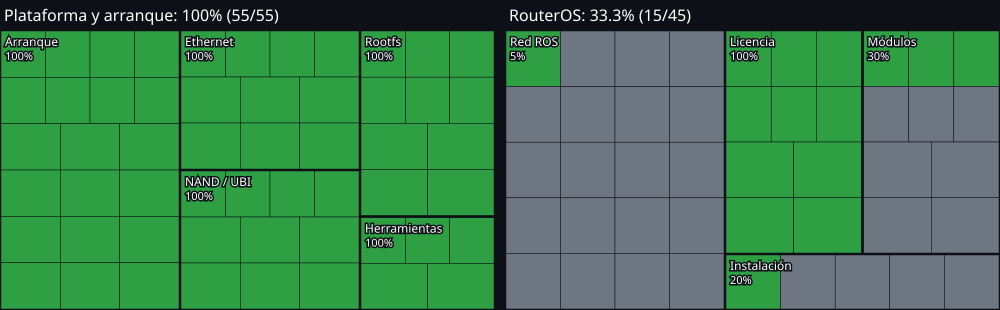

# Estado y progreso del port



**71% del port completado (71/100 puntos de peso).** Última actualización:
**2026-11-21**. El gráfico se genera desde [`progress.json`](../progress.json)
con [`tools/progress.py`](../tools/progress.py) y es el único elemento visual
del proyecto; todo el texto está en Markdown.

> **Alcance.** El porcentaje mide hitos de ingeniería del port, no líneas de
> código ni “porcentaje de RouterOS”. Un área al 100% significa que ese bloque
> está verificado o implementado en el alcance actual, no que RouterOS funcione
> entero. RouterOS y su rootfs son software de MikroTik; este repositorio no los
> redistribuye y no incluye ningún bypass de licencia.

---

## Cómo leer el mapa

El SVG tiene dos paneles:

- **Plataforma y arranque**: 55 puntos de peso; todo verificado en hardware.
- **RouterOS**: 45 puntos de peso; 16 completados.

Cada celda vale **un punto de peso**. Los pesos suman 100 y los puntos hechos
son `peso × porcentaje`; por eso `55 + 16 = 71`. Las celdas verdes son trabajo
hecho y las grises, trabajo pendiente. El color no distingue entre “parcial” y
“bloqueado”: eso se ve en la tabla y en el detalle de cada área.

El mapa se genera sin dependencias externas:

```bash
python3 tools/progress.py
```

No se genera HTML. `progress.svg` se embebe directamente en este documento y en
el [README](../README.md), y GitHub lo renderiza como imagen.

---

## Resumen de hitos

| # | Área | Peso | Hecho | % | Estado | Evidencia principal |
|---:|---|---:|---:|---:|---|---|
| 1 | Arranque y plataforma | 20 | 20 | 100% | verificado | `docs/BOOT-TFTP.md`, consola |
| 2 | Ethernet / switch / PHY en Linux | 10 | 10 | 100% | verificado | `dmesg` GSWIP, enlace 1 Gbps |
| 3 | NAND / UBI / UBIFS en lectura | 10 | 10 | 100% | verificado | `docs/NAND-UBI.md`, BBT |
| 4 | Rootfs / overlay / shell de RouterOS | 10 | 10 | 100% | verificado | `logs/` de consola (no versionados) |
| 5 | Módulos de RouterOS | 10 | 3 | 30% | parcial | `Unknown symbol` en logs |
| 6 | Red dentro de RouterOS | 20 | 1 | 5% | bloqueado | `packet_hook`, `switch`, `bridge2` |
| 7 | Licencia RouterOS | 10 | 10 | 100% | verificado | `RouterOS is now licensed`; `backtrace.log` |
| 8 | Instalación persistente / `.y3` | 5 | 2 | 40% | parcial | `docs/FLASH-Y3.md`, `tools/make-y3.sh`, `tools/verify-offline.sh`, `08-y3tool.py` |
| 9 | Herramientas remotas y documentación | 5 | 5 | 100% | verificado | `catch_final.py`, `uboot_cycle.py` |
| | **Total** | **100** | **71** | **71%** | | |

### Qué está verificado en hardware

- Kernel **5.6.3** de MikroTik para `mipsbe`, compilado para el GRX350 y
  arrancado por **TFTP a RAM**.
- Consola serie en `ttyLTQ0` a 115200 8N1.
- **Ethernet a 1 Gbps**: DSA, switch GSWIP XRX500 y PHY XWAY.
- **NAND de 128 MiB** (Macronix MX30LF1G18AC) con ECC BCH-4 y BBT.
- **UBI/UBIFS en lectura**: `rootfs_0` montado en solo lectura en las pruebas;
  `rootfs_1` se leyó para inspección, no forma parte del arranque actual.
- **Rootfs oficial de RouterOS**: Squashfs, overlay en tmpfs y shell `~ #`.
- `flash.ko` de RouterOS se integra en el kernel; `/flash` es tmpfs y
  `/dev/flash` existe.
- `/dev/log` con `devlog`, **licencia aceptada** (`RouterOS is now licensed`) y
  **loader/sysinit**: con `/dev/jiffies` arrancan 30 servicios y la web
  responde 200 en `192.168.1.2`.
- Con el `.y3` instalado, `/flash/rw` pasa a ser NAND; **pendiente de probar en
  placa**.

### Qué no está resuelto

- La **red dentro de RouterOS** sigue pendiente de probar en placa. El build
  #96 exportó los símbolos del *fastpath*, el #99 quitó GPL-only y el #102
  corrigió el ABI de `struct net_device` (`NET_CLS_ACT=n`) y dejó `br_init`
  stub con 18 exports retirados. La auditoría da cero pendientes y en QEMU
  malta 5.6.3 cargan `packet_hook`, `phy_helper`, `switch` y `bridge2`. Queda
  ver en placa si `switch.ko` engancha el GSWIP por switchdev, si `net` crea
  `ether1..4`, si `bridge2` registra `bridge` y si el datapath de `packet_hook`
  no rompe el camino lento. Detalle en [`NETWORK.md`](NETWORK.md).
- **Límite del objetivo:** la WAN del ED500 es xDSL (VRX518), no GPON: el
  firmware stock trae `vrx518.ko` y `drv_dsl_cpe_api.ko`, y ningún módulo
  PON/OMCI. RouterOS no tiene driver VRX518 y el de Genexis es binario para
  4.9.109. Sin ese driver no se puede tener un router MikroTik 100% con la WAN
  xDSL; el kernel Linux y `netup` dan Ethernet/gestión, no el router completo.
  Escribir un driver VRX518 desde cero queda fuera del alcance y no se puede
  verificar sin hardware.
- El **loader** ya no bloquea: la causa era `ROSMode::save()`, que necesita
  `/dev/jiffies`; con ese nodo creado, `sysinit` levanta 30 servicios y la web
  responde en `192.168.1.2:80` (prueba del 2026-11-21). El `STRONG FAIL` se
  sigue imprimiendo pero no impide el arranque. El build #95 crea el nodo y
  arranca `sysinit` directamente, sin shell de inspección; el #96 añade
  `autorun.scr` para fijar la contraseña de `admin` y la red. El #97 añade el
  botón de reset, los LEDs SSO/SK9822 y el mapa LED del PHY XWAY. El #98 añade
  el `.y3`, `/flash/rw` en NAND y el flag de arranque. Los cuatro están pendientes de
  probar en placa; el primer login con contraseña también.
- **Instalación y actualización:** Netinstall oficial no puede funcionar con
  el U-Boot de Genexis (MikroTik exige RouterBOOT/Etherboot). La actualización
  de RouterOS por `.npk` tampoco: el rootfs es el squashfs del initramfs y no
  hay instalador de paquetes que escriba en NAND. Con el `.y3` instalado, la
  configuración y los logs **sí** persisten en `/flash/rw` (NAND). Ver
  [`HARDWARE.md`](HARDWARE.md#netinstall-y-actualización-web).
- La **instalación persistente** en NAND está construida y verificada a nivel
  de contenedor (`.y3` de 422 LEBs, kernel/DTB byte a byte), pero **no se ha
  flasheado**. El arranque TFTP a RAM sigue siendo el método de prueba que no
  escribe flash.
- El build #93 es la última prueba en placa (2026-11-20): `/flash` tmpfs,
  `flash.ko`, `/dev/flash`, `/dev/log` con `devlog`, licencia aceptada y
  `sysinit` hasta el `loader`. El loader se desbloqueó después (#95) y la web
  respondió 200 en la prueba manual; los builds #95–#98 siguen pendientes de
  una prueba completa en placa.

---

## Detalle por área

### 1. Arranque y plataforma — 20/20 (100%, verificado)

**Qué funciona.** El ED500 arranca U-Boot, recibe `out/uImage-563` por TFTP y
ejecuta `bootm` en `0x80500000`. El kernel es Linux 5.6.3 con el mapa EVA del
GRX350, consola temprana `lantiq,0x16600000`, alias `serial0 → ttyLTQ0`, clocks
reales (`clk-grx500`, CGU, `CLK_SSX4`, `GCLK_UART`, `CLK_CPU`) y reboot por
`syscon-reboot`.

**Evidencia.** [`BOOT-TFTP.md`](BOOT-TFTP.md) documenta el cazador, los comandos
manuales y el reset remoto. Los logs completos están en `logs/` y no se
versionan porque pueden contener IPs o MACs.

**Límite actual.** El build #93 (`uImage` de 20.431.708 B, MD5
`1e113d9985a1a9fc68fa39fa97cc63e3`) está probado en placa el 2026-11-20: TFTP,
kernel 5.6.3, BBT, UBI, `rootfs_0`/`rootfs_1`, `/flash` tmpfs, `flash.ko`,
`/dev/flash`, `/dev/log` con `devlog` y `sysinit` hasta el `loader`. En la
prueba del 2026-11-21, con `/dev/jiffies` creado a mano, los servicios
arrancaron y la web respondió 200. El build #95 crea el nodo y arranca
`sysinit` directamente; está pendiente de probar. El #97 añade reset y LEDs,
también pendiente. La NAND no se ha escrito.

**Siguiente paso.** Probar el build #98 en placa: debe crear `/dev/jiffies`,
arrancar `sysinit` directo, dejar la red de gestión con `netup`, registrar el
botón y los LEDs y, tras instalar el `.y3`, montar `/flash/rw` en NAND. Después,
validar el primer login con la contraseña del autorun. Detalle en
[`LOADER.md`](LOADER.md) y [`HARDWARE.md`](HARDWARE.md).

### 2. Ethernet / switch / PHY en Linux — 10/10 (100%, verificado)

**Qué funciona.** El kernel ve el switch GSWIP XRX500 a través de DSA, usa el
tag `gswip3`, inicializa los PHY XWAY y establece enlace a **1 Gbps**. La bridge
del initramfs usa solo los puertos `lan*`, nunca el master DSA. `phyreg` y
`swstats` sirven para diagnosticar MDIO y contadores. El build #97 programa
los LEDs del PHY XWAY (LED0=1000M, LED1=10/100M) y enciende el *hardware
trigger* de los pines SSO correspondientes; está pendiente de placa.

**Evidencia.** `dmesg` muestra el switch, los PHY y el enlace; los detalles de
arranque están en [`BOOT-TFTP.md`](BOOT-TFTP.md).

**Límite actual.** Esto es Ethernet **en Linux**. Que el kernel tenga red no
significa que RouterOS pueda usarla: sus módulos de red dependen de su
*fastpath* y de su propio driver de switch. Es el muro del área 6.

**Siguiente paso.** Ninguno en el driver Linux para el alcance actual; el
trabajo pendiente está en la integración con RouterOS.

### 3. NAND / UBI / UBIFS en lectura — 10/10 (100%, verificado)

**Qué funciona.** La NAND Macronix MX30LF1G18AC (128 MiB SLC) se detecta con
ECC **BCH-4** y tabla de bloques malos (`nand-on-flash-bbt`). El BBT reporta
65472/65408 páginas. Con el offset correcto (`ubi.mtd=ubi,2048,30`) UBI
adjunta y `rootfs_0`/`rootfs_1` se montan en solo lectura. No se ha escrito
NAND.

**Nota (2026-11-20).** El build #70 arrancó y llegó al shell, pero UBI no
adjuntó: el bootargs solo llevaba `ubi.mtd=ubi` y, con BCH-4 por pasos de
512 B, UBI esperaba el VID header en 512 frente al 2048 de la flash
(`bad VID header offset 2048, expected 512`, `error -22`). Corregido y
revalidado en placa el 2026-11-20 con el build #71: `VID header offset: 2048
(aligned 2048), data offset: 4096`, `rootfs_0` y `rootfs_1` montados en ro.

**RouterBoot y `/flash` (builds #72–#93).** `flash.ko` aborta con `bad RouterBoot
MTD device` si no encuentra un MTD con ese nombre exacto
(`get_mtd_device_nm("RouterBoot")`, comprobado en el binario). La NAND del
ED500 no lo tiene. El kernel incorpora `mtdram` de 16 MiB con borrado de
128 KiB renombrado a `RouterBoot`: es RAM volátil, no toca la NAND y no
interviene en la licencia. Da a RouterOS un `/flash` para que `sysinit` pueda
seguir; el contenido se pierde al reiniciar.

En la prueba del build #72 (2026-11-20) el nombre bastó para que `flash.ko`
pasara de `bad RouterBoot MTD device` a `using MTD device`, pero el driver
abortó después con `vmalloc(0xffffffff)` / `could not get flash info`: la RAM
está en blanco y no tiene el *hard config* de RouterBoot. Sin `/dev/flash`,
`mount none /flash` sigue en `EINVAL`. El build #73 escribe antes de
`sysinit` un **hard config sintético** en el MTD RAM: cabecera RouterBoot y
bloque `Hard` con product ID 000, MAC real `34:e3:80:c3:77:f0` y serial
`W.3620220010`. Es identidad de hardware inventada para esta placa —como la
que RouterOS genera al instalarse en x86/arm64—, no un bypass de licencia, y
no toca la NAND. El build #76 añade el bloque `Soft` (magic `74666f53`) en
`0x8000` y verifica en consola `magics: hard=64726148 soft=74666f53`; con eso
`flash.ko` ya no aborta y registra `/dev/flash`. El build #77–#80 monta `/flash` como tmpfs en el init, así que el `mount none
/flash` ya no aparece. El #93 registra `/dev/flash`, crea `/dev/log` con
`devlog` y llega al `loader`; la licencia se acepta. Es un arreglo de
userland, no del hard/soft config.

**Evidencia.** [`NAND-UBI.md`](NAND-UBI.md) recoge geometría, parámetros y
montaje. BCH-4 y `nand-on-flash-bbt` son obligatorios: con BCH-8 no se puede
leer la UBI stock.

**Límite actual.** Leer no es instalar. No hay backup probado, no se ha hecho
una escritura controlada y no se ha validado la recuperación por el otro banco.
La actualización web de RouterOS escribe en `/flash`; aquí `/flash` es tmpfs y
la NAND es de solo lectura, así que no puede persistir. Netinstall oficial
tampoco es posible con el U-Boot de Genexis; ver [`HARDWARE.md`](HARDWARE.md).

**Siguiente paso.** Antes de cualquier escritura: backup completo, mapa de
particiones, geometría UBI y plan de recuperación. Sin eso, el método sigue
siendo TFTP a RAM.

### 4. Rootfs / overlay / shell de RouterOS — 10/10 (100%, verificado)

**Qué funciona.** El initramfs contiene el `rootfs.squashfs` oficial extraído
del `.npk` de RouterOS 7.17 mipsbe. El init monta un overlay en tmpfs y, desde
el build #72, cede el control a `/sbin/sysinit` (el arranque normal de
RouterOS). El shell de inspección `~ #` queda disponible con `ros.shell=1` en
los bootargs.

**Evidencia.** El log de consola del build #71 (2026-11-20) muestra UBI,
`rootfs_0`/`rootfs_1`, la carga de `flash.ko` y el shell. No se versiona
porque es un registro de hardware; no se incluye el rootfs de MikroTik en el
repo.

**Límite actual.** Es un arranque en RAM. El overlay es temporal y no hay
persistencia. La licencia y el `loader` ya no bloquean; falta el primer login.

**Siguiente paso.** El build #95 arranca `sysinit` directamente y crea
`/dev/jiffies` antes de cederle el control; el shell de inspección queda solo
con `ros.shell=1`. Hay que probarlo en placa y completar el primer login.

### 5. Módulos de RouterOS — 3/10 (30%, parcial)

**Qué funciona.** `flash.ko` se integra correctamente. La auditoría del build
#96 con `Module.symvers` muestra que `packet_hook.ko` sí define la mayor parte
del *fastpath* (`fast_path_start_xmit`, `register_fast_path`, `skb_bin_*`,
`custom_packet_hook_rx`, etc.). El único símbolo de esa API que faltaba en el
kernel era `netif_receive_try_fp`; el build #96 lo exporta. También activa los
símbolos de configuración que pedían estos módulos: VLAN 802.1Q, JUMP_LABEL,
USER_NS, XFRM/IPComp, netfilter/NAT, qdiscs, MII, I2C, GPIO, HWMON y LEDS.
Los seis módulos clave (`packet_hook`, `phy_helper`, `switch`, `bridge2`,
`8021q` y `nf_nat`) quedan sin símbolos pendientes.

**Qué falta probar.** `switch.ko` puede cargar con el #99, pero no está
probado que su capa switchdev enganche el GSWIP del GRX350; si el userland
pide un `switch_type` concreto, no lo tendrá. `bridge2.ko` registra el tipo
`bridge` y puede chocar con el bridge estándar del kernel (built-in para el
fallback de `netup`). El kernel ya llama a `rx_handler_hook`/`tx_handler_hook`
del fastpath; falta ver que `packet_hook` registre los puertos. Nada de esto
se ha probado en placa.

**Evidencia.** [`tools/audit_symbols.sh`](../tools/audit_symbols.sh) contra
`Module.symvers`, y [`NETWORK.md`](NETWORK.md). No se incluyen binarios de
MikroTik.

**Límite actual.** Los símbolos ya no son el muro; el límite es de hardware y
de registro de módulos. No se debe presentar como resuelto hasta verlo en placa.

**Siguiente paso.** Arrancar el #96 y revisar `dmesg`/`lsmod` tras `sysinit`,
más `/flash/rw/netup.log`.

### 6. Red dentro de RouterOS — 1/20 (5%, bloqueado)

**Qué funciona.** La red del kernel Linux (DSA/GSWIP/PHY) está verificada. Ese
es el 5% del área. El build #96 añade la capa de gestión: `autorun.scr` crea
bridge, IP y DHCP y fija `admin`; `netup` crea `br0`, asigna `192.168.1.2` y
arranca DHCP si RouterOS no levanta bridge, con `mgmt.vlan=NN` opcional. Está
implementado, no probado en placa.

**Qué falta.** Que RouterOS use esa red. El #102 añade `ros-name` a los
puertos DSA, que es lo que `net` lee para crear `ether1..4`, hace que el
autorun/`netup` prueben `ether1..4` o `lan1..4` y corrige el ABI de
`struct net_device` (`NET_CLS_ACT=n`: `pcpu_refcnt` en 672); en QEMU malta
5.6.3 cargan `packet_hook`, `phy_helper`, `switch` y `bridge2`. Falta la
placa: que `net` cree las interfaces, que `bridge2` registre `bridge` y que
`switch.ko` enganche el GSWIP. El kernel ya llama a los hooks del fastpath;
falta que `packet_hook` registre los puertos. El fallback de `netup` da
management Linux.

**Evidencia.** [`NETWORK.md`](NETWORK.md); auditorías de símbolos del #96 y del
#99; errores de los builds anteriores en
[TROUBLESHOOTING.md](TROUBLESHOOTING.md).

**Por qué sigue bloqueado.** Hasta el #98 `switch.ko` no cargaba por los
símbolos GPL-only; el #99 los elimina. Queda la prueba real en placa y el
*fastpath* completo, que no está en las fuentes GPL. Este repositorio no
redistribuye software propietario ni intenta saltarse esa dependencia.

**Siguiente paso.** Probar #96 en placa y separar dos casos: bridge estándar
(kernel) frente a `bridge2`, y `lan*` vistos por RouterOS frente a solo Linux.

### 7. Licencia RouterOS — 10/10 (100%, verificado)

**Qué funciona.** El `sysinit` acepta la licencia con la identidad RouterBoot
sintética (product ID 000, MAC real del ED500 y serial). El
`/flash/rw/logs/backtrace.log` del build #93 muestra `RouterOS is now licensed`.
No hay keygen, parche ni bypass de licencia; la identidad es la que RouterOS
espera en el bloque RouterBoot y es volátil.

**Evidencia.** `backtrace.log` (no versionado); consola del shell #93.

**Límite actual.** La licencia ya no bloquea. El `loader` arranca los
servicios si existe `/dev/jiffies`; la web responde 200. RouterOS rechaza la
contraseña vacía por red y el cambio de contraseña exige la consola en
exclusiva, así que el primer login sigue pendiente.

**Siguiente paso.** Fijar la contraseña de `admin` en la consola y validar
web/API. La licencia no requiere más cambios.

### 8. Instalación persistente / `.y3` — 2/5 (40%, parcial)

**Qué está hecho.** El formato `.y3` está estudiado, existe
[`08-y3tool.py`](../08-y3tool.py) y [`tools/make-y3.sh`](../tools/make-y3.sh)
construye el artefacto final:
`out/ED500-routeros-7.17-nand.y3` (53.613.270 B, MD5
`3e9b37d712ad6610bbaa2dc7d7ae2ccb`). Lleva una UBIFS de **422 LEBs** con
`/boot/uImage`, `/boot/norrland.dtb`, `/rw` y un `pad` de 30 MB; el kernel
dentro es byte a byte `out/uImage-563`. `run update_image` lo escribe en
**`rootfs_0`**, el único banco activo; no se usa la web stock ni el banco
siguiente. El init monta `rootfs_0` en rw en `/nand`, enlaza `/flash/rw` y
resetea **`boot_cnt_primary`** con `fw_setenv`; no hay lógica A/B. Todo está
verificado extrayendo la UBIFS y comparando los ficheros. Además,
`tools/verify-offline.sh` comprueba el entorno U-Boot redundante, el `bootok`
en `rootfs_0` (y que `rootfs_1` se ignora), el servicio caído, el entorno
ilegible, las rutas de autorun de `sysinit` y la recuperación stock; todo sin
abrir `/dev/mtd` ni `/dev/ubi`.

**Qué falta.** No se ha flasheado nada: ni la escritura en NAND, ni el arranque
de `iboot` con esta imagen, ni la persistencia tras reinicio, ni el flag de
arranque en hardware. El método de prueba que no escribe flash sigue siendo
TFTP a RAM.

**Nota (2026-11-20).** El MTD `RouterBoot` del build #72 es RAM volátil: no es
una instalación persistente ni escribe en la NAND. Solo evita que `flash.ko`
aborte antes de crear `/flash`.

**Por qué es delicado.** Una escritura incorrecta puede dejar el router sin
arranque. Antes hace falta backup, geometría UBI, plan de recuperación y una
prueba en el otro banco. El procedimiento está en
[`FLASH-Y3.md`](FLASH-Y3.md).

**Siguiente paso.** Con backup y consola: instalar el `.y3`, arrancar sin TFTP,
comprobar `/flash/rw` tras un reinicio y verificar que `bootok` baja
`boot_cnt_primary`. Si falla, la vuelta es manual con
`out/ED500-stock-original.y3` y `run update_image`; `rootfs_1` no se arranca
solo.

### 9. Herramientas remotas y documentación — 5/5 (100%, verificado)

**Qué funciona.** `catch_final.py` integra el cazador de U-Boot y el servidor
TFTP; `uboot_cycle.py` permite reset/catch/TFTP/`bootm` por consola; el build
`build-563.sh` es reproducible; la documentación está separada entre guías
actuales e histórico. El mapa de progreso se genera desde datos versionados y
se embebe en Markdown.

**Evidencia.** [`BUILD.md`](BUILD.md), [`BOOT-TFTP.md`](BOOT-TFTP.md),
[`CONTRIBUTING.md`](../CONTRIBUTING.md) y el propio
[`progress.json`](../progress.json).

**Límite actual.** Las herramientas están probadas, pero la prueba final del
artefacto actual sigue pendiente.

**Siguiente paso.** Mantener la documentación y el mapa sincronizados en cada
cambio de hito.

---

## Los bloqueos, en detalle

### A. Fastpath y switch de RouterOS

La auditoría del build #96 corrige una conclusión anterior: `packet_hook.ko`
**sí** define la mayor parte de la API del *fastpath*; solo faltaba
`netif_receive_try_fp`, que el kernel exporta desde el #96. Los demás símbolos
que fallaban eran de configuración (VLAN, JUMP_LABEL, USER_NS, XFRM,
netfilter, qdisc, MII, I2C...) y ya están activados.

El bloqueo que queda no es de enlazado:

- `switch.ko` ya puede cargar con el #99, pero no está probado que su capa
  switchdev enganche el GSWIP del GRX350.
- `bridge2.ko` ya carga en QEMU con el #102: `br_init` del kernel es un stub
  y se retiraron 18 exports duplicados. Falta probar en placa que registre
  `bridge` y que el fallback de `netup` siga disponible.
- `netif_receive_try_fp` es el `net_device` virtual de `fp_init`, no una
  función. El kernel ya llama a `rx_handler_hook`/`tx_handler_hook`; falta
  probar que `packet_hook` registre los puertos y que el camino rápido no
  rompa el tráfico.

**Consecuencia:** la red Linux y el management están cubiertos; que RouterOS
gestione bridge/VLAN como en un RouterBOARD sigue pendiente de prueba.

### B. Loader y servicios

La licencia ya se acepta (`RouterOS is now licensed`). El bloqueo real era
`ROSMode::save()`, que abre `/dev/jiffies`; el nodo no existía en el port. Con
un `/dev/jiffies` normal, `save()` completa y el `loader` levanta todos los
servicios. El `STRONG FAIL` se imprime igual, pero es una comprobación de
coherencia que no detiene el arranque.

**Consecuencia:** la licencia no es el muro; el `loader` sí.

### C. Persistencia en NAND

El arranque actual es TFTP a RAM. La NAND se lee, pero no se escribe. El `.y3`
está investigado, no probado. La persistencia exige backup, geometría y
recuperación; no es un paso que deba hacerse “a ver si sale”.

**Consecuencia:** cada arranque necesita el cazador TFTP; no hay instalación
permanente.

### D. Incidente del 2026-11-21

Durante las pruebas de la consola la placa quedó **haltada**. El shell de
inspección del initramfs y el `/bin/login` de RouterOS compartían `ttyLTQ0` y
se repartían los caracteres. Al intentar recuperar el control se envió un
BREAK y la placa dejó de responder por serie y por red, aunque el PHY mantiene
el enlace a 1 Gbps. No se escribió la NAND. Para volver a probar hace falta un
ciclo de corriente; el build #95 arranca `sysinit` directamente para que el
shell y el login no vuelvan a competir por la consola.

---

## Siguientes hitos

| Hito | Ahora | Meta | Qué lo desbloquea |
|---|---:|---:|---|
| Red dentro de RouterOS | 5% | 100% | *Fastpath* legal + `switch.ko` sobre switchdev, o una implementación propia |
| Licencia RouterOS | 100% | 100% | Aceptada con la identidad RouterBoot sintética; `RouterOS is now licensed` |
| GUI / Winbox / login | 50% | 100% | Servicios y web arriba; falta el primer login con contraseña |
| Instalación persistente | 40% | 100% | `.y3` construido; falta backup, escritura NAND, persistencia y recuperación en placa |
| Artefacto final probado | — | — | Arrancar `out/uImage-563` y el `.y3` en placa, y registrar el resultado |

No se debe subir el porcentaje de un área solo porque “parece que va a
funcionar”. Cada cambio debe tener evidencia reproducible.

---

## Artefacto actual

| Campo | Valor |
|---|---|
| Archivo | `out/uImage-563` |
| Tamaño | 21.899.532 bytes |
| MD5 | `e2e8698843a1278da58e5d9178c89f5a` |
| `vmlinux` | 111.798.704 bytes |
| Carga / entrada | `0x80500000` |
| Kernel | Linux 5.6.3 |
| `.y3` | `out/ED500-routeros-7.17-nand.y3`, 53.613.270 B, MD5 `3e9b37d712ad6610bbaa2dc7d7ae2ccb` |
| Última prueba en placa | build #93 (2026-11-20); los builds #95-#102 están construidos y pendientes de probar |
| Estado | #102 listo para TFTP y para instalar el `.y3`; GPL-only eliminado, `ros-name` en los puertos DSA, autorun/`netup` con `ether1..4`/`lan1..4` y ABI de `struct net_device` corregido; en QEMU malta cargan `packet_hook`/`phy_helper`/`switch`/`bridge2`; pendiente de placa que `net` cree las interfaces y que `switch.ko` enganche el GSWIP; reset/LEDs, `/flash/rw` en NAND, primer login y red/usuarios/VLAN pendientes de placa |

El MD5 identifica el artefacto que se está documentando, pero no demuestra que
esa imagen concreta haya arrancado. Para cerrar el hito: TFTP, `bootm`, consola,
montaje de UBI, `flash.ko` y shell; después anotar fecha y resultado.

### Qué cambia el build #96

- Kernel: VLAN 802.1Q, bridge VLAN filtering, JUMP_LABEL, USER_NS, XFRM +
  IPComp, netfilter/NAT, qdiscs, MII, I2C, GPIO, HWMON, LEDS y export de
  `netif_receive_try_fp`.
- Init: `/flash/autorun.scr` con `/delay 5`, contraseña de `admin`, bridge,
  `192.168.88.1` y DHCP; `netup` con `br0`, `192.168.1.2`, DHCP y
  `mgmt.vlan=NN`; sin `insmod` de diagnóstico antes de `sysinit`.
- Auditoría: 137 símbolos ausentes en total, pero **cero** en los seis módulos
  clave. El resto son de CIFS, crypto AEAD, USB y hardware que esta placa no
  usa.
- Artefacto: 21.063.928 B, MD5 `c6013342ae679c0eae4d425f2cbce368`. Cazador
  TFTP independiente con ventana de 72 h.

### Qué cambia el build #97

- Hardware: botón de reset físico (GPIO0 pin 0, 5 s), LEDs Ethernet y del panel
  frontal por SSO, RGB SK9822 en `canyon_led` y mapa LED del PHY XWAY.
- Pinctrl: compatible `intel,pinctrl-xrx500` y `request`/`free` por pinctrl;
  sin eso los bancos GPIO no se registraban.
- SSO: compuerta `GCLK_SSO`, reloj `fpid`, `SWU` para latchear las salidas
  software y `SSO_CON3` para el *hardware trigger* de los PHY.
- Artefacto: 21.123.448 B, MD5 `0f547b5f094d2467f272aadb5c4234d0`. Detalle y
  comprobación en [`HARDWARE.md`](HARDWARE.md).

### Qué cambia el build #98

- NAND: `out/ED500-routeros-7.17-nand.y3` con UBIFS de 422 LEBs en `rootfs_0`,
  `/boot/uImage`, `/boot/norrland.dtb`, `/rw` y `pad` de 30 MB. El `.y3` se
  instala por `run update_image`, en un solo banco; la web stock no se usa.
- Init: `/flash/rw` → `/nand/rw`, borrado del `pad`, `bootok` con
  `fw_printenv`/`fw_setenv` estáticos, solo `boot_cnt_primary`, y comprobación
  de la web/API por `tcp` y `tcp6`.
- Boot: `clk_ignore_unused` por defecto (el bootargs de NAND no lo trae) y
  `panic=20` para que un pánico devuelva el control a U-Boot.
- Artefacto: `uImage` 21.974.352 B, MD5 `66497d471a28741cc3055e10443a04cb`;
  `.y3` 53.740.246 B, MD5 `294043aac722ebc74dfbfbd7c3a33afa`. Detalle:
  [`FLASH-Y3.md`](FLASH-Y3.md).

### Qué cambia el build #99

- Exportaciones: `EXPORT_SYMBOL_GPL` pasa a `EXPORT_SYMBOL` en
  `include/linux/export.h` (switchdev, workqueue, GPIO, LED, hwmon, hrtimer,
  platform, sysfs, RCU, netfilter...). Es lo que hace el kernel de MikroTik
  para que sus módulos propietarios vean la API; no cambia la licencia del
  kernel.
- Auditoría: cero símbolos pendientes y cero GPL-only en `packet_hook`,
  `phy_helper`, `switch`, `bridge2`, `flash`, `8021q` y `nf_nat`.
- Artefacto: `uImage` 21.974.344 B, MD5
  `67f222246e47cfa0cb180bd25bdb4f25`; `.y3` 53.740.246 B, MD5
  `e3aee41c57dfa0f155e7734ecf6dcc71`. Pendiente de placa: si `switch.ko`
  engancha el GSWIP por switchdev.

### Qué cambia el build #100

- DTS: `ros-name = "ether4".."ether1"` en los puertos DSA 2..5; `net` lee
  `/sys/class/net/lanX/of_node/ros-name` y crea las interfaces RouterOS.
- Artefacto: `uImage` 21.974.456 B, MD5
  `978c6eceaefd55e00bb50bd9365336bb`; `.y3` 53.740.246 B, MD5
  `b68aaba26f06021c3b78e4af0b0ded1c`. Pendiente de placa: que `net` cree
  `ether1..4` y que `packet_hook`/`switch`/`bridge2` carguen.

### Qué cambia el build #101

- `init-initramfs.sh`: el autorun y `netup` prueban `ether1..4` y `lan1..4`,
  así el bridge no queda vacío si `net` renombra los puertos DSA.
- Artefacto: `uImage` 21.974.664 B, MD5
  `bcbddf8447a4152f7a0a2f9a7f095e90`; `.y3` 53.740.246 B, MD5
  `e865ee9f0518a9671e2935b903ddbbb3`. Pendiente de placa: que `net` cree
  `ether1..4`, que el bridge reciba los puertos y que
  `packet_hook`/`switch`/`bridge2` carguen.

### Qué cambia el build #102

- `CONFIG_NET_CLS_ACT=n`: sus dos `miniq_*` en `struct net_device` movían
  `pcpu_refcnt` de 672 a 680. Los módulos de RouterOS usan 672 y `packet_hook`
  hacía `dev_put()` sobre `todo_list.next` (NULL) al cargar. En QEMU se vio el
  Oops; con 672 los cuatro módulos cargan.
- `net/bridge`: `br_init` se corta antes de registrar pernet/link_ops/fdb y
  se retiran 18 exportaciones que `bridge2.ko` vuelve a definir. Sin eso el
  loader falla con `exports duplicate symbol br_forward` y luego EEXIST en
  `rtnl_link_register`; `brioctl_set` se conserva.
- Artefacto: `uImage` 21.899.532 B, MD5
  `e2e8698843a1278da58e5d9178c89f5a`; `.y3` 53.613.270 B, 422 LEBs, MD5
  `3e9b37d712ad6610bbaa2dc7d7ae2ccb`. QEMU malta 5.6.3: `packet_hook`,
  `phy_helper`, `switch` y `bridge2` cargan. Pendiente de placa: `net`,
  `switch`/GSWIP, bridge real y fastpath.

Todo esto está pendiente de probar en placa; el porcentaje no sube hasta
tener evidencia.

---

## Historial del port

### Fase 0 — Investigación

- SoC identificado: Intel/Lantiq **GRX350**, MIPS big-endian interAptiv.
- RouterOS 7.17 mipsbe verificado sobre Linux **5.6.3**.
- Fuentes GPL localizadas; mapa de memoria y EVA aclarados
  (`0x80500000 → 0x20500000`).
- Reparto de NAND y geometría UBI identificados.

### Fase 1 — Kernel 5.6.3

- Kernel compilado con `build=0`.
- Consola `ttyLTQ0`, earlycon y clocks reales.
- Driver GSWIP3/DSA y tag de switch portados.
- Config de usuarios: Squashfs, loop, tmpfs, netfilter, POSIX timers, etc.
- `uImage` empaquetado para `0x80500000`.

### Fase 2 — Initramfs

- Init sin dependencias de `ip`/`awk`/`wc`.
- Bridge solo con puertos `lan*`.
- `rootfs.squashfs` de RouterOS integrado cuando está disponible.
- Diagnóstico por consola y archivos `/www` en el initramfs.

### Fase 3 — Infraestructura de arranque

- `catch_final.py` con TFTP integrado, fallback de puerto y comprobación de
  tamaño.
- Transferencia TFTP verificada byte a byte.
- Reset por `syscon-reboot` y `panic=20`.
- `uboot_cycle.py` para reset/catch/TFTP/`bootm` remoto.

### Fase 4 — Primer arranque real

- Kernel 5.6.3 arranca en el ED500 por TFTP a RAM.
- Consola, Ethernet y NAND detectados.
- El rootfs de RouterOS llega a shell `~ #` con overlay.

### Fase 5 — Ethernet, NAND y UBI

- Ethernet DSA/GSWIP/PHY a 1 Gbps.
- NAND con BCH-4 y BBT; UBI/UBIFS en lectura.
- `rootfs_0`/`rootfs_1` montados en solo lectura.
- `flash.ko` de RouterOS cargado.

### Fase 6 — Límites del port

- Módulos de red de RouterOS fallan por símbolos del *fastpath*.
- La licencia demo ya no es el muro: se acepta con la identidad RouterBoot.
- Persistencia `.y3` investigada pero no probada.
- Artefacto final revalidado en placa (build #93).

### Fase 7 — `/flash`, licencia y loader (builds #72–#93)

- `/flash` tmpfs; `flash.ko` con `/dev/flash`; `/dev/log` con `devlog`.
- La licencia se acepta: `RouterOS is now licensed`.
- Muro actual: `loader` (`STRONG FAIL: this is not equal to that`, `read failed`).
- GUI, Winbox y login pendientes.

---

## Metodología del porcentaje

- Cada área tiene un **peso** que representa su importancia dentro del port.
- El porcentaje de cada área se basa en hitos verificables, no en líneas de
  código.
- Los puntos hechos son `peso × porcentaje / 100`.
- Los pesos suman 100; el total es la suma de puntos hechos.
- El SVG usa una celda por punto de peso: 70 celdas verdes de 100.
- `verified` = funciona en hardware o está reproducido con evidencia.
- `partial` = hay una parte funcional, pero queda un bloqueo conocido.
- `blocked` = depende de algo que el repo no puede resolver.
- Un 100% en un área **no** significa que RouterOS sea usable.

### Actualizar el mapa

1. Cambia el hito en [`progress.json`](../progress.json) (`percent`, `state`,
   `evidence`).
2. Ejecuta `python3 tools/progress.py`.
3. Revisa `progress.svg` o el README renderizado.
4. Haz commit de `progress.json` y `progress.svg` juntos.

No edites `progress.svg` a mano: se sobrescribe. No hay página HTML.

---

## Reproducir el estado actual

### Compilar

Requisitos y bootstrap completo en [`BUILD.md`](BUILD.md). El camino corto, si
`/opt/ros-port/linux-5.6.3` ya está preparado:

```bash
sudo bash build-563.sh
md5sum out/uImage-563
```

### Arrancar por TFTP

```bash
python catch_final.py --horas 6
# Windows: ARRANCAR-563.bat
```

El cazador sirve `out/uImage-563`, espera U-Boot, ejecuta `tftpboot` y `bootm`.
Todo va a RAM.

### Reset remoto

```bash
python uboot_cycle.py status
python uboot_cycle.py cycle
python uboot_cycle.py watch --horas 6
```

### Comprobar NAND/UBI

Ver [`NAND-UBI.md`](NAND-UBI.md). No escribir NAND sin backup y recuperación.

---

## Lo que no se ha probado

- `mount none /flash` sigue en `EINVAL` (fallo de `diskd`, no de `flash.ko`); no se ha probado un montaje alternativo.
- No se ha escrito NAND ni se ha probado el `.y3` en hardware.
- No se ha probado la GUI, Winbox ni el login de RouterOS con contraseña (la
  web responde 200, pero falta el primer login).
- No se ha probado la red de RouterOS del #96 (bridge, VLANs, `packet_hook`);
  el fallback Linux `192.168.1.2` tampoco se ha probado en placa.
- No se incluyen logs con IPs/MACs en el repositorio.

---

## Documentación relacionada

- [README del repositorio](../README.md)
- [Compilación](BUILD.md)
- [Arranque por TFTP](BOOT-TFTP.md)
- [Red, usuarios y VLANs](NETWORK.md)
- [NAND y UBI](NAND-UBI.md)
- [Troubleshooting](TROUBLESHOOTING.md)
- [Y3 / flasheo experimental](FLASH-Y3.md)
- [Cómo contribuir](../CONTRIBUTING.md)
- [Aviso legal](../NOTICE.md)
