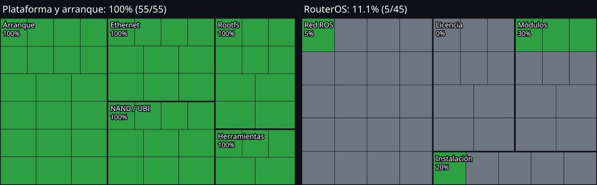

# Genexis Pure ED500 · RouterOS 7.17 research port (`mipsbe`)

Research port of **RouterOS 7.17 mipsbe** to the **Genexis Pure ED500**
(Intel/Lantiq **GRX350**, dual-core big-endian MIPS interAptiv), booted over
TFTP to RAM without writing flash.

[Progress](docs/PROGRESS.md) · [Progress map](progress.svg) ·
[Documentation](docs/README.md) · [Contributing](CONTRIBUTING.md) ·
[Legal notice](NOTICE.md)

> **Independent project.** Not affiliated with MikroTik, Genexis, or
> Intel/Lantiq. This repository does not include or redistribute MikroTik
> software. Obtain RouterOS packages and the root filesystem under MikroTik's
> terms.

## Overview

The ED500 has a GRX350 SoC, 128 MiB SLC NAND, a GSWIP switch, and XWAY PHYs.
RouterOS 7.17 `mipsbe` uses Linux 5.6.3, also published in MikroTik's GPL
sources. This project reuses that kernel, adds missing platform support, and
boots a separately obtained RouterOS root filesystem in RAM.

This repository contains tools, patches, and documentation for research. It is
not a complete alternative firmware.

## Current status



**60% complete (60/100 weighted points).** See
[docs/PROGRESS.md](docs/PROGRESS.md) for the milestone breakdown and evidence.

- **Verified:** Linux 5.6.3, `ttyLTQ0`, Linux Ethernet through DSA/GSWIP at
  1 Gbps, BCH-4/BBT NAND detection, read-only UBI/UBIFS, and the RouterOS
  rootfs inspection shell with a temporary overlay.
- **Not working:** RouterOS networking, due to unavailable MikroTik fastpath
  symbols and a platform-specific switch driver.
- **License status:** RouterOS reports `Demo license expired!`. The recorded
  `getHardwareID` diagnostic cannot obtain the expected disk identity from
  `/dev/mtdblock0`; the NAND contains Genexis/Adamo firmware. The repository
  records no further license validation on this device.
- **Persistence:** not tested. The current method is TFTP to RAM; NAND is not
  written.
- **Artifact:** `out/uImage-563` builds with `build-563.sh`, but needs another
  hardware test. The latest recorded test used earlier builds (#29/#62).

## Quick start

### Requirements

- Linux or WSL2 with permission to write under `/opt`.
- Bootlin MIPS toolchain `mips32--glibc--stable-2024.05-1`.
- Linux 5.6.3 sources, MikroTik GPL patch, and `mips.config`.
- `make`, `bc`, `flex`, `bison`, `libssl-dev`, `libelf-dev`, `xz-utils`,
  `patch`, `wget`, `mkimage` (`u-boot-tools`), `squashfs-tools`, `cpio`,
  `gzip`, `bzip2`, and Python 3.
- An official RouterOS 7.17 `mipsbe` package from which to extract
  `ros/rootfs.squashfs`. Do not commit or redistribute it.
- Serial console at 115200 8N1 (`COM4` by default; override with `ED500_PORT`).

### Prepare and build

```bash
python3 -m pip install -r requirements.txt
```

Place the separately obtained root filesystem at `ros/rootfs.squashfs`. For
bootstrap steps and build checks, see [docs/BUILD.md](docs/BUILD.md). If
`/opt/ros-port/linux-5.6.3` is already prepared:

```bash
sudo bash build-563.sh
```

### Boot to RAM over TFTP

```bash
python catch_final.py --horas 6
# Windows: ARRANCAR-563.bat
```

The catcher serves `out/uImage-563`, waits for U-Boot, transfers the image, and
runs `bootm`. This does not write NAND. See [docs/BOOT-TFTP.md](docs/BOOT-TFTP.md).

### Remote reset

```bash
python uboot_cycle.py status
python uboot_cycle.py cycle
python uboot_cycle.py watch --horas 6
```

## Repository map

| Path | Purpose |
|---|---|
| `build-563.sh` | Current kernel build and `out/uImage-563` packaging |
| `parche_arranque.py` | Idempotent kernel/platform boot patches |
| `init-initramfs.sh` | Initramfs, overlay, networking, and read-only NAND/UBI setup |
| `phyreg.c`, `swstats.c` | PHY and switch diagnostics |
| `catch_final.py`, `tftplib.py` | U-Boot catcher and TFTP server |
| `uboot_cycle.py` | Serial reset, TFTP, and boot helpers |
| `docs/` | Current guides and historical notes |
| `tools/progress.py`, `progress.json`, `progress.svg` | Progress map generator, data, and output |
| `refs/`, `tree/` | Reference DTS and platform patches |
| `ros/`, `out/`, `logs/` | Local-only inputs, artifacts, and logs |

## Documentation

- [Progress](docs/PROGRESS.md)
- [Build](docs/BUILD.md)
- [TFTP boot](docs/BOOT-TFTP.md)
- [NAND and UBI](docs/NAND-UBI.md)
- [Troubleshooting](docs/TROUBLESHOOTING.md)
- [`.y3` research status](docs/FLASH-Y3.md)
- [Documentation index](docs/README.md)

## Legal and safety scope

- RouterOS, `.npk` files, root filesystems, and NAND dumps are not included or
  redistributed.
- The default boot method is TFTP to RAM. Do not write NAND without a verified
  backup and a recovery plan.
- Sanitize logs before publishing them.
- See [NOTICE.md](NOTICE.md) for third-party licensing information.

Documentation, reproducibility, diagnostics, and original driver contributions
are welcome. See [CONTRIBUTING.md](CONTRIBUTING.md).
