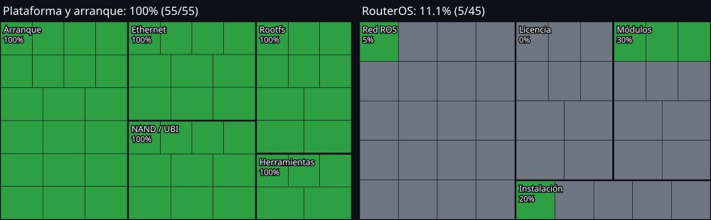

# Estado y progreso del port



**60% del port completado (60/100 puntos de peso).** Última actualización:
**2026-11-19**. El gráfico se genera desde [`progress.json`](../progress.json)
con [`tools/progress.py`](../tools/progress.py) y es el único elemento visual
del proyecto; todo el texto está en Markdown.

> **Alcance.** El porcentaje mide hitos de ingeniería del port, no líneas de
> código ni “porcentaje de RouterOS”. Un área al 100% significa que ese bloque
> está verificado o implementado en el alcance actual, no que RouterOS funcione
> entero. RouterOS y su rootfs son software de MikroTik; este repositorio no los
> redistribuye y no incluye ningún bypass de licencia.

---

## Cómo leer el mapa

El SVG tiene dos paneles:

- **Plataforma y arranque**: 55 puntos de peso; todo verificado en hardware.
- **RouterOS**: 45 puntos de peso; solo 5 completados.

Cada celda vale **un punto de peso**. Los pesos suman 100 y los puntos hechos
son `peso × porcentaje`; por eso `55 + 5 = 60`. Las celdas verdes son trabajo
hecho y las grises, trabajo pendiente. El color no distingue entre “parcial” y
“bloqueado”: eso se ve en la tabla y en el detalle de cada área.

El mapa se genera sin dependencias externas:

```bash
python3 tools/progress.py
```

No se genera HTML. `progress.svg` se embebe directamente en este documento y en
el [README](../README.md), y GitHub lo renderiza como imagen.

---

## Resumen de hitos

| # | Área | Peso | Hecho | % | Estado | Evidencia principal |
|---:|---|---:|---:|---:|---|---|
| 1 | Arranque y plataforma | 20 | 20 | 100% | verificado | `docs/BOOT-TFTP.md`, consola |
| 2 | Ethernet / switch / PHY en Linux | 10 | 10 | 100% | verificado | `dmesg` GSWIP, enlace 1 Gbps |
| 3 | NAND / UBI / UBIFS en lectura | 10 | 10 | 100% | verificado | `docs/NAND-UBI.md`, BBT |
| 4 | Rootfs / overlay / shell de RouterOS | 10 | 10 | 100% | verificado | `logs/` de consola (no versionados) |
| 5 | Módulos de RouterOS | 10 | 3 | 30% | parcial | `Unknown symbol` en logs |
| 6 | Red dentro de RouterOS | 20 | 1 | 5% | bloqueado | `packet_hook`, `switch`, `bridge2` |
| 7 | Licencia RouterOS | 10 | 0 | 0% | bloqueado | `Demo license expired!` |
| 8 | Instalación persistente / `.y3` | 5 | 1 | 20% | parcial | `docs/FLASH-Y3.md`, `08-y3tool.py` |
| 9 | Herramientas remotas y documentación | 5 | 5 | 100% | verificado | `catch_final.py`, `uboot_cycle.py` |
| | **Total** | **100** | **60** | **60%** | | |

### Qué está verificado en hardware

- Kernel **5.6.3** de MikroTik para `mipsbe`, compilado para el GRX350 y
  arrancado por **TFTP a RAM**.
- Consola serie en `ttyLTQ0` a 115200 8N1.
- **Ethernet a 1 Gbps**: DSA, switch GSWIP XRX500 y PHY XWAY.
- **NAND de 128 MiB** (Macronix MX30LF1G18AC) con ECC BCH-4 y BBT.
- **UBI/UBIFS en lectura**: `rootfs_0` y `rootfs_1` montados en solo lectura.
- **Rootfs oficial de RouterOS**: Squashfs, overlay en tmpfs y shell `~ #`.
- `flash.ko` de RouterOS se integra en el kernel.

### Qué no está resuelto

- La **red dentro de RouterOS** no funciona: faltan el *fastpath* binario de
  MikroTik y un driver de switch para el GSWIP del GRX350.
- La **licencia demo** no es válida en esta NAND; el *software ID* de RouterOS
  depende de un disco MikroTik que aquí no existe.
- La **instalación persistente** en NAND no se ha probado. El método actual es
  TFTP a RAM; no se ha escrito la flash.
- El artefacto final `out/uImage-563` **no se ha vuelto a probar en placa**
  después de la reorganización. La última prueba registrada es de los builds
  #29/#62.

---

## Detalle por área

### 1. Arranque y plataforma — 20/20 (100%, verificado)

**Qué funciona.** El ED500 arranca U-Boot, recibe `out/uImage-563` por TFTP y
ejecuta `bootm` en `0x80500000`. El kernel es Linux 5.6.3 con el mapa EVA del
GRX350, consola temprana `lantiq,0x16600000`, alias `serial0 → ttyLTQ0`, clocks
reales (`clk-grx500`, CGU, `CLK_SSX4`, `GCLK_UART`, `CLK_CPU`) y reboot por
`syscon-reboot`.

**Evidencia.** [`BOOT-TFTP.md`](BOOT-TFTP.md) documenta el cazador, los comandos
manuales y el reset remoto. Los logs completos están en `logs/` y no se
versionan porque pueden contener IPs o MACs.

**Límite actual.** La imagen final se compiló correctamente (`build=0`,
`vmlinux` de 96.385.720 B y `uImage` de 19.672.756 B, MD5
`1a780fdd76b9da701974b17af1102be6`), pero la última prueba en hardware
registrada es anterior. Hay que repetir el arranque antes de presentar el
artefacto como “probado”.

**Siguiente paso.** Arrancar `out/uImage-563` por TFTP, comprobar el tamaño
transferido, la consola y el shell, y anotar el resultado junto al MD5.

### 2. Ethernet / switch / PHY en Linux — 10/10 (100%, verificado)

**Qué funciona.** El kernel ve el switch GSWIP XRX500 a través de DSA, usa el
tag `gswip3`, inicializa los PHY XWAY y establece enlace a **1 Gbps**. La bridge
del initramfs usa solo los puertos `lan*`, nunca el master DSA. `phyreg` y
`swstats` sirven para diagnosticar MDIO y contadores.

**Evidencia.** `dmesg` muestra el switch, los PHY y el enlace; los detalles de
arranque están en [`BOOT-TFTP.md`](BOOT-TFTP.md).

**Límite actual.** Esto es Ethernet **en Linux**. Que el kernel tenga red no
significa que RouterOS pueda usarla: sus módulos de red dependen de su
*fastpath* y de su propio driver de switch. Es el muro del área 6.

**Siguiente paso.** Ninguno en el driver Linux para el alcance actual; el
trabajo pendiente está en la integración con RouterOS.

### 3. NAND / UBI / UBIFS en lectura — 10/10 (100%, verificado)

**Qué funciona.** La NAND Macronix MX30LF1G18AC (128 MiB SLC) se detecta con
ECC **BCH-4** y tabla de bloques malos (`nand-on-flash-bbt`). El BBT reporta
65472/65408 páginas. UBI se attacha y `rootfs_0`/`rootfs_1` se montan en solo
lectura. No se ha escrito NAND.

**Evidencia.** [`NAND-UBI.md`](NAND-UBI.md) recoge geometría, parámetros y
montaje. BCH-4 y `nand-on-flash-bbt` son obligatorios: con BCH-8 no se puede
leer la UBI stock.

**Límite actual.** Leer no es instalar. No hay backup probado, no se ha hecho
una escritura controlada y no se ha validado la recuperación por el otro banco.

**Siguiente paso.** Antes de cualquier escritura: backup completo, mapa de
particiones, geometría UBI y plan de recuperación. Sin eso, el método sigue
siendo TFTP a RAM.

### 4. Rootfs / overlay / shell de RouterOS — 10/10 (100%, verificado)

**Qué funciona.** El initramfs contiene el `rootfs.squashfs` oficial extraído
del `.npk` de RouterOS 7.17 mipsbe. El init monta un overlay en tmpfs, carga
`flash.ko` y deja un shell de inspección con prompt `~ #` dentro del rootfs de
RouterOS.

**Evidencia.** Los logs de consola de los builds #29/#62 muestran el montaje,
la carga de `flash.ko` y el shell. No se versionan porque son registros de
hardware; no se incluye el rootfs de MikroTik en el repo.

**Límite actual.** Es un arranque en RAM. El overlay es temporal y no hay
persistencia. La licencia sigue siendo el bloqueo del área 7.

**Siguiente paso.** Repetir con el `uImage-563` final y conservar un log
redactado que confirme el mismo resultado.

### 5. Módulos de RouterOS — 3/10 (30%, parcial)

**Qué funciona.** `flash.ko` se integra correctamente.

**Qué falla.** `packet_hook.ko`, `switch.ko`, `bridge2.ko` y `phy_helper.ko`
piden símbolos que no están en las fuentes GPL ni en ningún `.ko` del paquete:
`netif_receive_try_fp`, `fast_path_start_xmit`, `register_fast_path`,
`skb_bin_*`, `phy_setup`, `custom_packet_hook_rx`, entre otros. Son parte del
*fastpath* binario de MikroTik. Además, `switch.ko` es el driver de *sus*
switches, no del GSWIP del GRX350.

**Evidencia.** Los errores `Unknown symbol` están resumidos en
[`TROUBLESHOOTING.md`](TROUBLESHOOTING.md) y en los logs de diagnóstico. No se
incluyen binarios de MikroTik.

**Límite actual.** No es un problema de configuración de RouterOS ni algo que se
arregle con un `insmod` adicional. Falta código propietario o una alternativa
propia.

**Siguiente paso.** Documentar qué módulos cargan y cuáles no en cada build, y
evaluar una vía propia para la pila de red. No se debe presentar como resuelto.

### 6. Red dentro de RouterOS — 1/20 (5%, bloqueado)

**Qué funciona.** La red del kernel Linux (DSA/GSWIP/PHY) está verificada. Ese
es el 5% del área.

**Qué falta.** Que RouterOS use esa red. Sus módulos de bridge, packet hook y
switch no enlazan contra el kernel porque esperan el *fastpath* binario. Sin
ese componente, las interfaces de RouterOS no quedan operativas aunque el
kernel tenga `lan*` y la bridge del initramfs.

**Evidencia.** Errores de símbolos de `packet_hook`, `switch`, `bridge2` y
`phy_helper`; [`TROUBLESHOOTING.md`](TROUBLESHOOTING.md).

**Por qué está bloqueado.** No hay fuentes GPL del *fastpath* y no existe un
driver RouterOS para el GSWIP del GRX350. Este repositorio no redistribuye
software propietario ni intenta saltarse esa dependencia.

**Siguiente paso.** Solo se desbloquea con una implementación propia compatible
o con una pieza binaria obtenida legalmente. No es un cambio de configuración.

### 7. Licencia RouterOS — 0/10 (0%, bloqueado)

**Qué pasa.** RouterOS deriva su *software ID* del disco (`/dev/mtdblock0`) y
aquí la NAND contiene el firmware Adamo, no un disco formateado por MikroTik.
La comprobación termina en `Demo license expired!`. Una licencia CHR (x86) no
sirve para este equipo MIPS BE.

**Evidencia.** `getHardwareID` y `Demo license expired!` en la consola;
[`TROUBLESHOOTING.md`](TROUBLESHOOTING.md).

**Por qué está bloqueado.** Es una decisión de licencia de MikroTik. Este
repositorio no incluye *keygen*, parche de licencia, modificación del
*software ID* ni instrucciones para evitar el chequeo. Si se quiere usar
RouterOS, hace falta una licencia válida para este hardware.

**Siguiente paso.** Ninguno dentro del alcance legal del repo. Se puede seguir
investigando el resto del port sin saltarse la licencia.

### 8. Instalación persistente / `.y3` — 1/5 (20%, parcial)

**Qué se sabe.** El formato `.y3` está estudiado y existe
[`08-y3tool.py`](../08-y3tool.py) para inspeccionarlo. La documentación histórica
está en [`FLASH-Y3.md`](FLASH-Y3.md).

**Qué falta.** No se ha flasheado nada. No hay una prueba de escritura en NAND
ni una recuperación verificada. El método actual es TFTP a RAM y no toca la
flash.

**Por qué es delicado.** Una escritura incorrecta puede dejar el router sin
arranque. Antes hace falta backup, geometría UBI, plan de recuperación y una
prueba en el otro banco.

**Siguiente paso.** No ejecutar el `.y3` sin esas condiciones. Documentar el
backup y la recuperación antes de intentar la persistencia.

### 9. Herramientas remotas y documentación — 5/5 (100%, verificado)

**Qué funciona.** `catch_final.py` integra el cazador de U-Boot y el servidor
TFTP; `uboot_cycle.py` permite reset/catch/TFTP/`bootm` por consola; el build
`build-563.sh` es reproducible; la documentación está separada entre guías
actuales e histórico. El mapa de progreso se genera desde datos versionados y
se embebe en Markdown.

**Evidencia.** [`BUILD.md`](BUILD.md), [`BOOT-TFTP.md`](BOOT-TFTP.md),
[`CONTRIBUTING.md`](../CONTRIBUTING.md) y el propio
[`progress.json`](../progress.json).

**Límite actual.** Las herramientas están probadas, pero la prueba final del
artefacto actual sigue pendiente.

**Siguiente paso.** Mantener la documentación y el mapa sincronizados en cada
cambio de hito.

---

## Los bloqueos, en detalle

### A. Fastpath y switch de RouterOS

RouterOS no usa la pila de red genérica de Linux para todo: sus módulos de
paquete, bridge y switch esperan una API binaria de MikroTik. Los símbolos que
faltan no están en las fuentes GPL ni en los `.ko` publicados. No es un
`modprobe` que falte; es una dependencia propietaria.

Además, el GSWIP del GRX350 no es uno de los switches que soporta `switch.ko`.
Aunque se resolviera el *fastpath*, haría falta el driver correcto para este
SoC.

**Consecuencia:** la red dentro de RouterOS queda bloqueada. El kernel Linux
puede tener Ethernet, pero RouterOS no puede usarla como su red de gestión.

### B. Licencia y *software ID*

RouterOS calcula el *software ID* a partir de un disco MikroTik. La NAND de este
ED500 contiene Adamo, no ese disco. El resultado es una licencia demo expirada.
No hay una licencia CHR aplicable a MIPS BE.

**Consecuencia:** no se puede activar RouterOS en este hardware sin una licencia
válida. El repo no intenta evitar el control.

### C. Persistencia en NAND

El arranque actual es TFTP a RAM. La NAND se lee, pero no se escribe. El `.y3`
está investigado, no probado. La persistencia exige backup, geometría y
recuperación; no es un paso que deba hacerse “a ver si sale”.

**Consecuencia:** cada arranque necesita el cazador TFTP; no hay instalación
permanente.

---

## Siguientes hitos

| Hito | Ahora | Meta | Qué lo desbloquea |
|---|---:|---:|---|
| Red dentro de RouterOS | 5% | 100% | *Fastpath* legal + driver GSWIP, o una implementación propia |
| Licencia RouterOS | 0% | 100% | Licencia válida para este hardware; fuera del alcance del repo |
| Instalación persistente | 20% | 100% | Backup, UBI, recuperación y prueba controlada en NAND |
| Artefacto final probado | — | — | Arrancar `out/uImage-563` y registrar el resultado |

No se debe subir el porcentaje de un área solo porque “parece que va a
funcionar”. Cada cambio debe tener evidencia reproducible.

---

## Artefacto actual

| Campo | Valor |
|---|---|
| Archivo | `out/uImage-563` |
| Tamaño | 19.672.756 bytes |
| MD5 | `1a780fdd76b9da701974b17af1102be6` |
| `vmlinux` | 96.385.720 bytes |
| Carga / entrada | `0x80500000` |
| Kernel | Linux 5.6.3 |
| Última prueba en placa | builds #29/#62; el artefacto final está pendiente |
| Estado | compilado y empaquetado; **no revalidado en hardware** |

El MD5 identifica el artefacto que se está documentando, pero no demuestra que
esa imagen concreta haya arrancado. Para cerrar el hito: TFTP, `bootm`, consola,
montaje de UBI, `flash.ko` y shell; después anotar fecha y resultado.

---

## Historial del port

### Fase 0 — Investigación

- SoC identificado: Intel/Lantiq **GRX350**, MIPS big-endian interAptiv.
- RouterOS 7.17 mipsbe verificado sobre Linux **5.6.3**.
- Fuentes GPL localizadas; mapa de memoria y EVA aclarados
  (`0x80500000 → 0x20500000`).
- Reparto de NAND y geometría UBI identificados.

### Fase 1 — Kernel 5.6.3

- Kernel compilado con `build=0`.
- Consola `ttyLTQ0`, earlycon y clocks reales.
- Driver GSWIP3/DSA y tag de switch portados.
- Config de usuarios: Squashfs, loop, tmpfs, netfilter, POSIX timers, etc.
- `uImage` empaquetado para `0x80500000`.

### Fase 2 — Initramfs

- Init sin dependencias de `ip`/`awk`/`wc`.
- Bridge solo con puertos `lan*`.
- `rootfs.squashfs` de RouterOS integrado cuando está disponible.
- Diagnóstico por consola y archivos `/www` en el initramfs.

### Fase 3 — Infraestructura de arranque

- `catch_final.py` con TFTP integrado, fallback de puerto y comprobación de
  tamaño.
- Transferencia TFTP verificada byte a byte.
- Reset por `syscon-reboot` y `panic=20`.
- `uboot_cycle.py` para reset/catch/TFTP/`bootm` remoto.

### Fase 4 — Primer arranque real

- Kernel 5.6.3 arranca en el ED500 por TFTP a RAM.
- Consola, Ethernet y NAND detectados.
- El rootfs de RouterOS llega a shell `~ #` con overlay.

### Fase 5 — Ethernet, NAND y UBI

- Ethernet DSA/GSWIP/PHY a 1 Gbps.
- NAND con BCH-4 y BBT; UBI/UBIFS en lectura.
- `rootfs_0`/`rootfs_1` montados en solo lectura.
- `flash.ko` de RouterOS cargado.

### Fase 6 — Límites del port

- Módulos de red de RouterOS fallan por símbolos del *fastpath*.
- Licencia demo expirada; no hay disco MikroTik.
- Persistencia `.y3` investigada pero no probada.
- Artefacto final pendiente de revalidación.

---

## Metodología del porcentaje

- Cada área tiene un **peso** que representa su importancia dentro del port.
- El porcentaje de cada área se basa en hitos verificables, no en líneas de
  código.
- Los puntos hechos son `peso × porcentaje / 100`.
- Los pesos suman 100; el total es la suma de puntos hechos.
- El SVG usa una celda por punto de peso: 60 celdas verdes de 100.
- `verified` = funciona en hardware o está reproducido con evidencia.
- `partial` = hay una parte funcional, pero queda un bloqueo conocido.
- `blocked` = depende de algo que el repo no puede resolver.
- Un 100% en un área **no** significa que RouterOS sea usable.

### Actualizar el mapa

1. Cambia el hito en [`progress.json`](../progress.json) (`percent`, `state`,
   `evidence`).
2. Ejecuta `python3 tools/progress.py`.
3. Revisa `progress.svg` o el README renderizado.
4. Haz commit de `progress.json` y `progress.svg` juntos.

No edites `progress.svg` a mano: se sobrescribe. No hay página HTML.

---

## Reproducir el estado actual

### Compilar

Requisitos y bootstrap completo en [`BUILD.md`](BUILD.md). El camino corto, si
`/opt/ros-port/linux-5.6.3` ya está preparado:

```bash
sudo bash build-563.sh
md5sum out/uImage-563
```

### Arrancar por TFTP

```bash
python catch_final.py --horas 6
# Windows: ARRANCAR-563.bat
```

El cazador sirve `out/uImage-563`, espera U-Boot, ejecuta `tftpboot` y `bootm`.
Todo va a RAM.

### Reset remoto

```bash
python uboot_cycle.py status
python uboot_cycle.py cycle
python uboot_cycle.py watch --horas 6
```

### Comprobar NAND/UBI

Ver [`NAND-UBI.md`](NAND-UBI.md). No escribir NAND sin backup y recuperación.

---

## Lo que no se ha probado

- El `out/uImage-563` final no se ha vuelto a arrancar en placa.
- No se ha escrito NAND ni se ha probado el `.y3` en hardware.
- No se ha validado una licencia RouterOS en este equipo.
- No se ha probado la red de RouterOS con el *fastpath* (no está disponible).
- No se incluyen logs con IPs/MACs en el repositorio.

---

## Documentación relacionada

- [README del repositorio](../README.md)
- [Compilación](BUILD.md)
- [Arranque por TFTP](BOOT-TFTP.md)
- [NAND y UBI](NAND-UBI.md)
- [Troubleshooting](TROUBLESHOOTING.md)
- [Y3 / flasheo experimental](FLASH-Y3.md)
- [Cómo contribuir](../CONTRIBUTING.md)
- [Aviso legal](../NOTICE.md)
